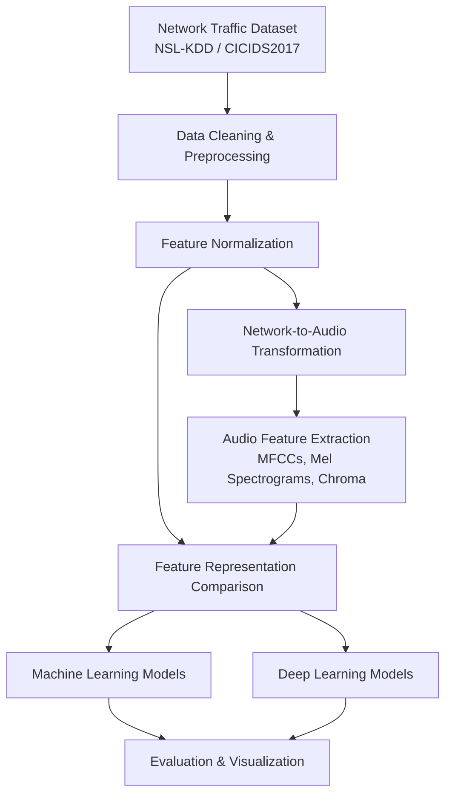

# EchoShield: Audio-Based Network Intrusion Detection System

<p align="center">
  <em>Exploring network security through audio signal processing and machine learning.</em>
</p>

EchoShield is an experimental cybersecurity research project that investigates an unconventional approach to Network Intrusion Detection Systems (NIDS): **transforming network traffic records into audio signals and using audio-derived features to identify potentially malicious activity.**

By combining signal processing, feature engineering, machine learning, and deep learning, EchoShield explores whether an acoustic representation of network behavior can preserve useful information for distinguishing benign traffic from cyberattacks.

The project uses the **NSL-KDD dataset** as its primary benchmark and supports experimentation with **CICIDS2017**. It compares models trained on conventional network features with models trained on audio-derived representations to investigate their relative effectiveness.

> **Research focus:** Can the sound of network traffic reveal useful patterns for intrusion detection?

## ✨ Key Features

- 🎵 **Network-to-Audio Transformation:** Converts normalized network flow features into synthesized audio signals.
- 🔊 **Audio Feature Extraction:** Uses Librosa to extract Mel-Frequency Cepstral Coefficients (MFCCs), mel spectrograms, chroma features, and other audio descriptors.
- 🤖 **Machine Learning-Based Detection:** Evaluates conventional machine learning models using network-based and audio-derived features.
- 🧠 **Deep Learning Experiments:** Explores neural network architectures for learning discriminative patterns from audio representations.
- 📊 **Comparative Evaluation:** Compares detection performance using classification metrics such as precision, recall, and F1-score.
- 📈 **Experiment Visualization:** Supports analysis through evaluation reports, plots, and visualizations.
- 🔬 **Reproducible Research:** Organizes datasets, notebooks, scripts, and evaluation outputs into a structured experimental workflow.

## 🏗️ System Architecture

EchoShield follows a multi-stage pipeline that transforms structured network traffic into audio representations before model training and evaluation.



### How It Works

**1. Dataset Preparation**

Load and preprocess network intrusion detection data, beginning with NSL-KDD. Prepare labels and features for downstream analysis.

**2. Feature Normalization**

Normalize numerical network features to a common range to support consistent processing and audio synthesis.

**3. Network-to-Audio Transformation**

Map normalized network feature values to selected frequencies and combine sine waves to synthesize audio signals representing network records.

**4. Audio Feature Extraction**

Use Librosa to derive representations such as MFCCs, mel spectrograms, chroma features, and other relevant acoustic descriptors.

**5. Model Training**

Train machine learning and deep learning models on conventional network features and audio-derived features, maintaining comparable data splits wherever possible.

**6. Performance Evaluation**

Evaluate and compare models using classification metrics, confusion matrices, and visualizations to understand the strengths and limitations of each representation.

## 🛠️ Tech Stack

| Category | Technologies |
|---|---|
| Programming Language | Python 3.11 |
| Machine Learning | Scikit-learn, XGBoost, LightGBM |
| Deep Learning | PyTorch, Torchvision |
| Audio Processing | Librosa |
| Data Processing | NumPy, Pandas |
| Visualization | Matplotlib |
| Experimentation | Jupyter Notebook |
| Datasets | NSL-KDD, CICIDS2017 |

## 📂 Project Structure

```text
Audio-Based-Network-Intrusion-Detection-System/
├── data/
│   └── raw/                  # Raw dataset files
├── notebooks/                # Data analysis and experiments
├── reports/                  # Metrics, results, and figures
├── scripts/
│   ├── run_pipeline.py       # Training and evaluation pipeline
│   └── run_notebooks.py      # Notebook execution utility
├── src/                      # Core implementation modules
│   └── download_data.py      # Dataset download utility, if located here
├── requirements.txt          # Python dependencies
├── LICENSE                   # MIT License
└── README.md
```

*The structure above is illustrative. Adjust file paths to match the actual repository, particularly the location of `download_data.py`.*

## 🚀 Getting Started

### Prerequisites

- Python 3.11
- pip
- Git
- An NVIDIA GPU with compatible CUDA support is recommended for deep learning experiments; CPU execution may also be possible depending on the model and workload.

### 1. Clone the Repository

```bash
git clone https://github.com/enigmatronix13/Audio-Based-Network-Intrusion-Detection-System.git
cd Audio-Based-Network-Intrusion-Detection-System
```

### 2. Create a Virtual Environment

```bash
python -m venv venv
```

Activate the environment.

**Windows:**

```bash
venv\Scripts\activate
```

**Linux / macOS:**

```bash
source venv/bin/activate
```

### 3. Install Dependencies

Install the project dependencies:

```bash
python -m pip install --upgrade pip
pip install -r requirements.txt
```

If these packages are not already included in `requirements.txt`, install them separately:

```bash
pip install shap lightgbm
```

For an NVIDIA GPU setup, install a PyTorch build compatible with your CUDA environment. For example, the CUDA 12.4 build can be installed with:

```bash
pip install torch torchvision --index-url https://download.pytorch.org/whl/cu124
```

Choose the appropriate PyTorch installation command for your hardware and operating system. Avoid reinstalling PyTorch unnecessarily if a compatible version is already installed.

### 4. Download the Dataset

If the repository includes the dataset download utility at `src/download_data.py`, run:

```bash
python src/download_data.py
```

Alternatively, download the datasets from their official or authorized distribution sources and place the files in the directory expected by the pipeline.

- **NSL-KDD:** Primary benchmark dataset for intrusion detection experiments.
- **CICIDS2017:** Additional dataset for broader experimentation and generalization analysis.

Ensure that dataset paths and preprocessing configurations match those expected by the scripts.

### 5. Run the Pipeline

Execute the training and evaluation pipeline:

```bash
python scripts/run_pipeline.py
```

### 6. Run the Notebooks

To execute the notebooks using the repository's utility script:

```bash
python scripts/run_notebooks.py
```

Alternatively, launch Jupyter Notebook:

```bash
jupyter notebook
```

Open the relevant notebook in the `notebooks/` directory to explore the data, preprocessing, experiments, and results.

## 📊 Evaluation Methodology

EchoShield evaluates the usefulness of audio-derived representations by comparing them with conventional numerical network features.

### Evaluation Metrics

- **Accuracy:** Overall proportion of correctly classified samples.
- **Precision:** Proportion of predicted positive samples that are actually positive.
- **Recall:** Proportion of actual positive samples correctly identified.
- **F1-score:** Harmonic mean of precision and recall.
- **Confusion Matrix:** Breakdown of correct and incorrect predictions across classes.

Depending on the experiment, evaluation may include binary classification of benign versus malicious traffic or multiclass classification of different traffic or attack categories.

### Experimental Comparison

| Experiment | Objective |
|---|---|
| Conventional network features | Establish a baseline using structured network data |
| Audio-derived features | Evaluate the discriminative value of acoustic representations |
| Machine learning models | Compare traditional classifiers across feature representations |
| Deep learning models | Investigate learned representations and nonlinear patterns |
| Cross-dataset evaluation | Explore generalization to different traffic distributions |

**Interpreting the results:** Comparisons should use consistent data splits, label definitions, and evaluation metrics wherever possible. Audio-derived features should be assessed against appropriate baselines to determine whether they provide additional predictive value.

## 🔬 Research Objectives

EchoShield investigates the following questions:

1. Can network traffic records be transformed into meaningful audio representations?
2. Do audio-derived features preserve information useful for distinguishing benign and malicious traffic?
3. How do audio-based models compare with models trained on conventional network features?
4. Which audio representations and model architectures are most effective for this task?
5. How well do the resulting models generalize across datasets and previously unseen attack categories?

## ⚠️ Limitations

- **Experimental scope:** Results on benchmark datasets do not necessarily generalize to live network environments.
- **Representation quality:** Mapping structured network features to audio introduces design choices that may affect the information retained.
- **Computational overhead:** Audio synthesis and feature extraction may increase processing time and resource requirements.
- **Class imbalance:** Uneven representation of traffic classes can affect evaluation metrics and model behavior.
- **Generalization:** Performance on one dataset does not establish effectiveness against new attack types or changing traffic distributions.
- **Real-time feasibility:** Latency, throughput, scalability, and operational integration require separate evaluation.

EchoShield is a research framework, not a validated production-ready intrusion detection system. Its findings should be interpreted as experimental evidence rather than a guarantee of real-world security performance.

## 🔮 Future Work

Potential directions for extending the project include:

- Experimenting with alternative network-to-audio encoding strategies.
- Comparing MFCCs, mel spectrograms, chroma features, and other audio representations.
- Evaluating additional machine learning and deep learning architectures.
- Investigating cross-dataset generalization and unseen attack categories.
- Improving robustness to class imbalance and evolving network threats.
- Measuring computational overhead and exploring the feasibility of real-time detection.

## 📄 License

This project is distributed under the MIT License. See the [`LICENSE`](LICENSE) file for details.

## 💡 Final Note

EchoShield explores cybersecurity from a different signal: **the sound of network traffic.**

By combining audio signal processing with machine learning, the project investigates an alternative representation of network behavior and its potential value for intrusion detection research.

